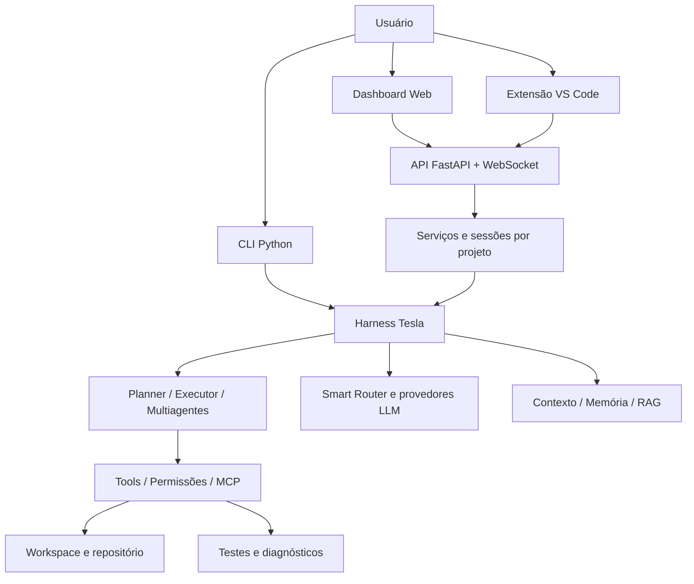
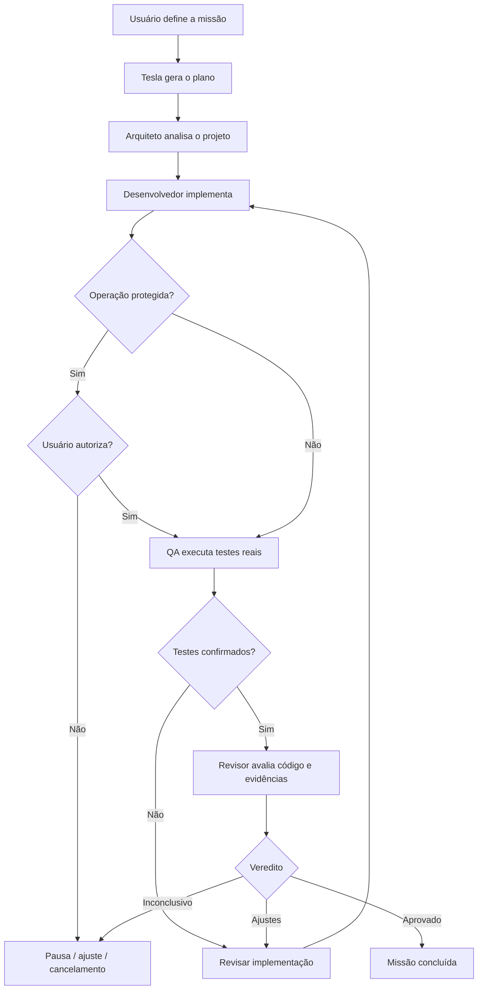

<div align="center">


# Tesla Agent

**Agente de IA para desenvolvimento de software e automações, construído em Python com harness próprio.**

Do terminal ao Dashboard Web e à integração com VS Code, com a evolução do código documentada em cada versão.

[](https://www.python.org/)
[](versions/v0.7.0/README.md)
[](LICENSE)
[](#roadmap)

**Criado por Guilherme Hendrik**

[GitHub](https://github.com/MrHendrix0611) · [LinkedIn](https://www.linkedin.com/in/guilherme-hendrik-59775326a/) · [Instagram](https://www.instagram.com/hxtech_/)

[Sobre](#sobre-o-projeto) · [Origem do nome](#origem-do-nome) · [Funcionalidades](#funcionalidades) · [Versões](#histórico-de-versões) · [Instalação](#como-executar-a-v070) · [Arquitetura](#arquitetura-da-v070) · [Roadmap](#roadmap)

</div>

---

## Sobre o projeto

Comecei o Tesla Agent com uma pergunta: **quanto um modelo de IA pequeno ou gratuito consegue entregar quando recebe um harness bem estruturado?**

O projeto explora essa ideia com código real. Em vez de depender apenas do modelo, o Tesla combina contexto, ferramentas, permissões, planejamento, execução de testes e revisão. O objetivo é tornar tarefas de desenvolvimento e automação mais controláveis, verificáveis e reproduzíveis.

A primeira versão era uma CLI simples e se chamava **Hefesto Agent**. Nas versões seguintes vieram os provedores de LLM, Skills, ferramentas, memória, RAG, MCP e a orquestração multiagentes. **Na v0.7.0, o projeto ganhou um Dashboard Web e uma extensão inicial para VS Code.**

Este repositório preserva os snapshots e READMEs de **v0.1 a v0.7.0**. Cada pasta permite acompanhar o que foi implementado, quais comandos estavam disponíveis e como a arquitetura mudou.

> **Estado do projeto:** experimental e em evolução. A v0.7.0 é a versão mais recente disponível; não é apresentada como produto pronto para ambientes de produção.

## Origem do nome

O nome **Tesla Agent** foi escolhido como uma homenagem a **Nikola Tesla (1856–1943)**, inventor e engenheiro cujas contribuições à eletricidade e à engenharia representam o espírito de investigação, criatividade e inovação que inspira este projeto.

Essa referência é **ao inventor Nikola Tesla, e não à fabricante de veículos Tesla, Inc.** O Tesla Agent é um projeto autoral e independente de software livre, desenvolvido por **Guilherme Hendrik**, com foco em inteligência artificial, automação e engenharia de software.

> **Declaração de independência:** o **Tesla Agent não possui vínculo, afiliação, patrocínio, autorização ou endosso da Tesla, Inc., de Elon Musk ou de suas empresas**. O nome é utilizado aqui em homenagem histórica ao inventor Nikola Tesla, sem intenção de sugerir qualquer relação empresarial ou comercial com essas organizações.

## Objetivos

- Explorar o impacto do **harness engineering** no uso prático de modelos pequenos, gratuitos e locais.
- Construir um agente modular, com suporte a diferentes provedores e ferramentas.
- Permitir desenvolvimento assistido por IA com aprovações, testes e revisão de código.
- Manter o histórico técnico acessível, para que outras pessoas possam estudar e contribuir.

## Funcionalidades

| Recurso | O que faz |
|---|---|
| **CLI** | Conversas, seleção de projeto, comandos e execução local. |
| **Dashboard Web** | Chat, seleção de workspace, arquivos, atividades, aprovações e acompanhamento de planos. |
| **Extensão VS Code** | Painel do agente ao lado do editor, chat, workspace e autorizações conectados ao servidor local. |
| **Multi-LLM / Smart Router** | Uso e seleção de provedores como OpenRouter, Groq, Gemini e Ollama, conforme a configuração. |
| **Skills e Tools** | Instruções especializadas e ferramentas para arquivos, terminal, Git e busca. |
| **Permissões e custos** | Aprovação de operações protegidas e controle de uso de modelos pagos. |
| **Repository Intelligence** | Mapeamento do projeto, busca no código e localização de símbolos. |
| **Planejamento e multiagentes** | Planner/Executor e papéis de Arquiteto, Desenvolvedor, QA e Revisor. |
| **Coding Agent** | Escrita de código, diffs, rollback e execução de testes `unittest`. |
| **Memória e RAG** | Notas persistentes por projeto e recuperação contextual de arquivos indexados. |
| **MCP** | Integração com servidores de ferramentas externas via stdio. |
| **Observabilidade** | Eventos, histórico operacional, auditoria e métricas locais de uso. |

As funcionalidades variam conforme a versão. O Dashboard e a extensão VS Code estão disponíveis a partir da **v0.7.0**.

## O que mudou na v0.7.0

A principal novidade é poder utilizar o Tesla sem depender exclusivamente da CLI:

- **Dashboard local** servido por uma API FastAPI, com chat, explorador de arquivos e painéis de ferramentas, memória e multiagentes.
- **Extensão inicial do VS Code** executada em modo de desenvolvimento, conectada ao backend por token local.
- **Aprovações pela interface** para ações como escrita de arquivos e execução de testes.
- **Persistência de projetos e planos**, melhorando a continuidade entre o navegador e a CLI.
- **Melhorias no controle de execução**, nos vereditos do Revisor e na apresentação de resultados do QA.
- **Nova identidade visual** com símbolo próprio no dashboard e na extensão.

Para detalhes técnicos e comandos de cada interface, consulte o [README da v0.7.0](versions/v0.7.0/README.md).

## Histórico de versões

| Versão | Principal evolução | Código e documentação |
|:---|---|---|
| **v0.1** | Fundação do agente e CLI | [Explorar v0.1](versions/v0.1/README.md) |
| **v0.2** | Seleção de provedores | [Explorar v0.2](versions/v0.2/README.md) |
| **v0.3** | Contexto conversacional | [Explorar v0.3](versions/v0.3/README.md) |
| **v0.4** | Skills especializadas | [Explorar v0.4](versions/v0.4/README.md) |
| **v0.5** | Tools, permissões e execução | [Explorar v0.5](versions/v0.5/README.md) |
| **v0.5.1** | Multi-LLM e fallback | [Explorar v0.5.1](versions/v0.5.1/README.md) |
| **v0.5.2** | Smart Router e controle de uso | [Explorar v0.5.2](versions/v0.5.2/README.md) |
| **v0.5.3** | Aprovação de modelos pagos | [Explorar v0.5.3](versions/v0.5.3/README.md) |
| **v0.5.4** | Observabilidade e auditoria | [Explorar v0.5.4](versions/v0.5.4/README.md) |
| **v0.5.5** | Repository Intelligence e identidade Tesla | [Explorar v0.5.5](versions/v0.5.5/README.md) |
| **v0.5.6** | Planner, Executor e checkpoints | [Explorar v0.5.6](versions/v0.5.6/README.md) |
| **v0.5.7** | Coding Agent: diff, rollback e testes | [Explorar v0.5.7](versions/v0.5.7/README.md) |
| **v0.5.8** | Memória de projeto e RAG lexical | [Explorar v0.5.8](versions/v0.5.8/README.md) |
| **v0.5.9** | Integração MCP via stdio | [Explorar v0.5.9](versions/v0.5.9/README.md) |
| **v0.6.0** | Orquestração multiagentes | [Explorar v0.6.0](versions/v0.6.0/README.md) |
| **v0.7.0** | Dashboard Web, VS Code e estabilização | **[Explorar v0.7.0](versions/v0.7.0/README.md)** |

> **Nota histórica:** os commits e tags montados a partir dos snapshots são reconstruções retrospectivas e não reproduzem necessariamente o histórico original de desenvolvimento.

## Como executar a v0.7.0

### Pré-requisitos

- Python 3 instalado e disponível no terminal (exemplos em Windows/PowerShell).
- Git para clonar o repositório.
- Chave de API do provedor remoto escolhido, se aplicável; para uso local, configure o Ollama conforme o README da versão.

### 1. Clonar e entrar na versão

```powershell
git clone https://github.com/MrHendrix0611/tesla-agent.git
cd tesla-agent\versions\v0.7.0
```

### 2. Instalar dependências

```powershell
py -m pip install -r requirements.txt
```

### 3. Configurar o ambiente

```powershell
Copy-Item .env.example .env
notepad .env
```

Preencha apenas as credenciais necessárias. **O arquivo `.env` é privado e não deve ser publicado.**

### 4. Iniciar o Dashboard Web

```powershell
py -m web.main
```

Abra **http://127.0.0.1:8765** e selecione a pasta do projeto em que deseja trabalhar. Mantenha o terminal do servidor aberto enquanto usar o painel.

### 5. Usar a CLI (opcional)

Em outro terminal, na mesma pasta da v0.7.0:

```powershell
py -m cli.main
```

### 6. Testar a instalação

```powershell
py -m unittest discover -s tests -v
```

**Estado da validação:** os 9 cenários funcionais de homologação do Dashboard, CLI e extensão foram reportados como aprovados em Windows. Em uma execução posterior da suíte automatizada no Windows, **122 testes rodaram, com 3 falhas e 1 erro**, envolvendo caminhos, finais de linha, HTTP e bloqueio de arquivo. Esses pontos seguem registrados para correção; não estamos declarando a suíte automatizada integralmente aprovada.

### Integração com Visual Studio Code

A extensão está incluída no projeto, mas **ainda não é uma extensão publicada na Marketplace**. Para testá-la:

1. Inicie o servidor com `py -m web.main` e copie o token local exibido no terminal.
2. Abra `versions/v0.7.0/vscode-extension` no VS Code (ou a pasta `vscode-extension`, caso já esteja dentro da versão).
3. Pressione `F5` para abrir a janela **Extension Development Host**.
4. Na paleta de comandos (`Ctrl + Shift + P`), execute **Tesla: Conectar ao agente local** e informe o token atual.
5. Execute **Tesla: Abrir painel Agent** e selecione o workspace.

## Arquitetura da v0.7.0

A CLI, o Dashboard e a extensão utilizam o mesmo núcleo Python. O servidor local conecta as interfaces visuais ao agente e às operações autorizadas.



### Fluxo de uma missão multiagentes



Os diagramas simplificam o funcionamento. Confirmações, checkpoints e retomadas dependem das ferramentas e configurações disponíveis.

## Roadmap

| Versão | Situação | Direção |
|---|---|---|
| **v0.7.0** | Implementada; manutenção em andamento | Dashboard Web, integração inicial com VS Code e estabilização. |
| **v0.8.0** | Planejada | Aplicação desktop independente. |
| **v0.9.0** | Planejada | Tesla IDE: editor de código, explorador e terminal integrados. |
| **v1.0.0** | Planejada | Consolidação, segurança, distribuição e experiência completa. |

## Segurança e limitações

O Tesla pode ler e modificar arquivos e executar comandos locais. Antes de aprovar uma ação, confira os argumentos, o destino e as alterações propostas.

- Nunca publique `.env`, tokens de extensão, credenciais, logs locais ou dados privados de projetos.
- Execute primeiro em pastas de teste e revise os diffs antes de aplicar alterações importantes.
- Respostas de LLMs não substituem testes e revisão de código.
- A v0.7.0 é experimental: o resultado depende de ambiente, dependências e provedores configurados.

## Licença

Distribuído sob a **Licença MIT**. Consulte o arquivo [LICENSE](LICENSE) para os termos completos.

## Contribuindo

Relatos de bugs, melhorias e documentação são bem-vindos. Para colaborar, consulte [CONTRIBUTING.md](CONTRIBUTING.md) ou abra uma issue no repositório.

## Autor

**Guilherme Hendrik** — criador e desenvolvedor do Tesla Agent.

- **GitHub:** [@MrHendrix0611](https://github.com/MrHendrix0611)
- **LinkedIn:** [Guilherme Hendrik](https://www.linkedin.com/in/guilherme-hendrik-59775326a/)
- **Instagram:** [@hxtech_](https://www.instagram.com/hxtech_/)

---

<div align="center">

**Tesla Agent · Desenvolvimento aberto, versão por versão.**

</div>
