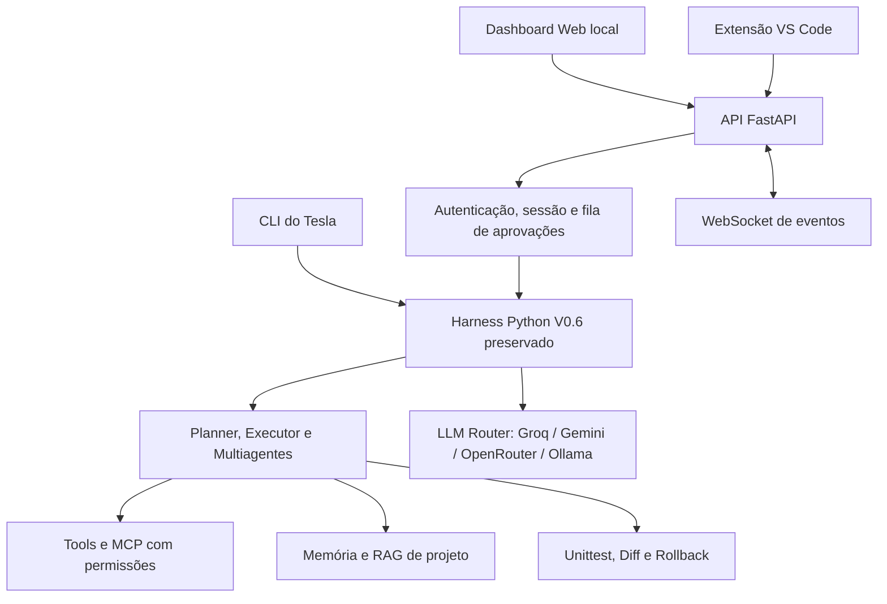
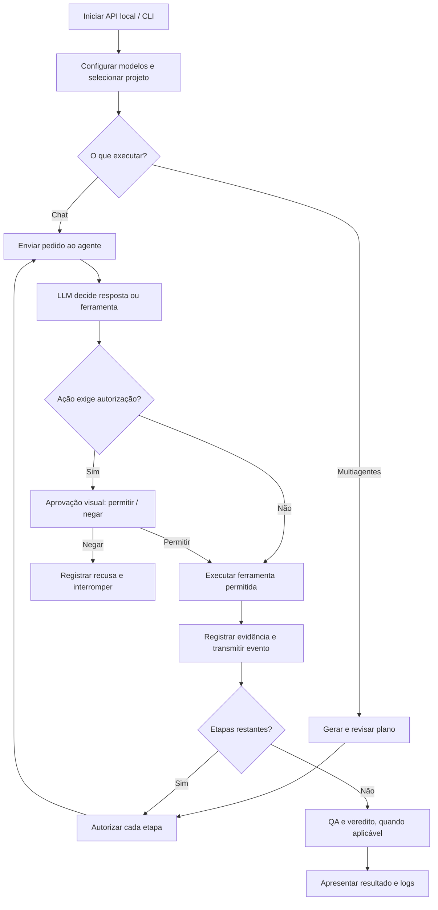

<div align="center">

# ⚡ Tesla Agent V0.7.0

### Dashboard Web, API local e integração inicial com VS Code

Agente de IA para engenharia de software, desenvolvido em Python com harness próprio.

**Criador:** [Guilherme Hendrik](https://github.com/MrHendrix0611)

[GitHub](https://github.com/MrHendrix0611) · [LinkedIn](https://www.linkedin.com/in/guilherme-hendrik-59775326a/) · [Instagram](https://www.instagram.com/hxtech_/)

[Histórico de versões](../../README.md) · [Extensão VS Code](vscode-extension/README.md)

</div>

---

## 1. Descrição

A **V0.7.0** inaugura a interface visual local do Tesla. Ela disponibiliza o agente em um **dashboard no navegador** e em um **painel inicial do VS Code**, por meio de uma API FastAPI que reutiliza o mesmo núcleo Python da V0.6.0. A **CLI continua funcionando** com seus comandos anteriores.

O objetivo do projeto é explorar como um harness bem estruturado pode tornar modelos acessíveis — inclusive modelos menores e gratuitos — mais úteis em tarefas reais de desenvolvimento de software.

## 2. Objetivo desta versão

Fornecer uma forma visual de selecionar projetos, conversar com o agente, gerenciar planos multiagentes, revisar alterações, aprovar ações, consultar memória e acompanhar ferramentas, **sem duplicar o motor de execução** nem retirar suas proteções.

Esta é uma **aplicação local**, não um serviço multiusuário ou público na internet.

## 3. Funcionalidades e entregas

| Componente | Implementação V0.7.0 |
|---|---|
| Web Workbench | Interface escura responsiva, chat e explorador de arquivos, com prévia de código |
| API FastAPI | Endpoints REST locais, validação de entrada e autenticação por token temporário |
| Atualização em tempo real | Eventos por WebSocket: início/fim de jobs, atividades, aprovações, execução de ferramentas e etapas; histórico de execuções por projeto sem prompts |
| Aprovações visuais | Autorizar/negar escrita, patches, testes, etapas e chamadas pagas quando o roteador solicitar |
| Multiagentes | Planejar, executar, repetir etapa, rework e cancelar plano com relatórios completos, vereditos legíveis e evidência real do QA |
| Diff | Visualização da última alteração registrada pelo sistema de coding do Tesla |
| Modelos | Selecionar Auto Router ou um provedor **já configurado** no `.env` |
| Memória/RAG | Consultar notas, adicionar decisões e realizar busca lexical no projeto |
| Ferramentas/MCP | Consultar status dos servidores MCP, ferramentas e consumo; execução MCP ainda usa a CLI |
| Testes | Executar `unittest` pelo navegador, com aprovação humana |
| VS Code | Extensão inicial: chat, seleção da pasta aberta, aprovações, reconexão com validação de token e emblema da Tesla |
| CLI anterior | `/team`, `/plan`, `/test`, `/mcp`, `/project`, Skills, Router, memória e demais comandos preservados |

### Limites conhecidos

- O dashboard utiliza **HTML, CSS e JavaScript sem dependências de front-end** para rodar imediatamente. React/TypeScript foi avaliado no planejamento, mas **não está presente como framework de interface nesta entrega**. A integração nativa do VS Code também é JavaScript.
- A extensão é uma integração **inicial em painel**, não uma IDE própria, nem edição textual direta dentro do painel.
- Planos de um mesmo projeto são persistidos em `.tesla/plan.json`; execuções autônomas usam bloqueio entre processos. **Chat avulso e operações manuais da CLI não são integralmente serializados entre interfaces**: evite edições simultâneas no mesmo arquivo.
- O cancelamento é cooperativo: chamadas já iniciadas na API do modelo ou processos de teste podem precisar terminar antes de encerrar a tarefa. O plano pausado permanece para revisão e retry.
- `qa_verified` agora registra evidência de `run_tests` (quantidade e exit code). `review_approved` requer veredito explícito do Revisor; ainda assim, nenhum deles garante ausência de bugs.
- Roteamento, Skills, memória, controle de custos, RAG e MCP mantêm as limitações conhecidas da V0.6.0.
- Não foram realizadas chamadas reais a modelos pagos/remotos nesta validação. Antes de utilizar, configure suas credenciais e limites de orçamento.

## 4. Instalação — Windows / PowerShell

Requisitos: **Python 3.10+**, Python Launcher `py`, navegador e (opcional) VS Code. Para LLMs remotas, são necessárias credenciais do provedor; para Ollama, a instância local precisa estar configurada.

Abra o terminal na **pasta desta versão**, `versions/v0.7.0`:

```powershell
py -m pip install -r requirements.txt
Copy-Item .env.example .env
notepad .env
```

Preencha **suas próprias credenciais** no `.env` local. Não comite nem envie o arquivo ao GitHub. Também configure `PAID_USAGE_MODE=never` e `MONTHLY_PAID_BUDGET_USD=0` para proibir modelos pagos por padrão.

### Executar o Dashboard Web

```powershell
py -m web.main
```

Acesse **http://127.0.0.1:8765**. Selecione o projeto **pela interface**, informando o caminho completo da pasta existente, como `F:\Projetos\MeuProjeto`.

O servidor anuncia um **token temporário no console**, necessário para a extensão VS Code; mantenha-o privado. A extensão agora valida o token antes de salvá-lo e oferece **Reconectar** caso o servidor seja reiniciado. O navegador aberto diretamente no servidor recebe um token de sessão via página local. O último workspace é restaurado a partir de `~/.tesla-agent/workbench.json` (apenas o caminho da pasta, sem credenciais). A porta escuta apenas em `127.0.0.1`, não na rede.

### Executar a CLI antiga

```powershell
py -m cli.main
```

A CLI conserva os comandos anteriores. Ao utilizar `/project` e `/team`, ela consulta o mesmo checkpoint `.tesla/plan.json` usado pelo dashboard. **Não edite o mesmo arquivo simultaneamente por duas interfaces.**

### Executar testes

```powershell
py -m unittest discover -s tests -v
```

Os testes de API usam `fastapi.testclient` (`httpx`). A suíte simula chamadas de LLM para não consumir tokens nem gastar crédito de API.

## 5. Comandos existentes na CLI

| Comando | Função |
|---|---|
| `/project <caminho>` | Seleciona um projeto |
| `/workspace` | Mostra o workspace |
| `/skills`, `/skill <nome>`, `/skill off` | Lista/ativa/desativa Skills |
| `/tools` | Lista ferramentas |
| `/router`, `/usage`, `/paid`, `/stats`, `/audit` | Roteamento, consumo e auditoria |
| `/map`, `/find <texto>`, `/symbols [termo]` | Inteligência do repositório |
| `/plan create <objetivo>`, `/plan`, `/steps` | Planejamento autônomo |
| `/resume`, `/retry <id>`, `/cancel` | Execução controlada com checkpoints |
| `/team roles`, `/team create <objetivo>`, `/team` | Orquestração e inspeção de papéis |
| `/team run`, `/team retry <id>`, `/team rework` | Executar, repetir ou reabrir etapas |
| `/diff <arquivo>`, `/rollback <arquivo>` | Alterações e rollback |
| `/test [all\|discover\|módulo]` | Testes `unittest` |
| `/index`, `/recall <tema>` | Indexação e busca lexical RAG |
| `/remember <nota>`, `/memories`, `/forget <id>` | Memória persistente de projeto |
| `/context`, `/clearcontext` | Contexto da sessão |
| `/mcp`, `/mcp config`, `/mcp connect <nome>` | Gerenciar servidores MCP |
| `/mcp tools <nome>`, `/mcp call <servidor> <tool> <json>` | Ferramentas MCP |
| `/mcp disconnect <nome>`, `/diagnose`, `/sair` | Desconectar, diagnosticar e sair |

Os novos controles estão no dashboard, não em comandos CLI extras.

## 6. Endpoints principais da API local

| Método | Endpoint | Função |
|---|---|---|
| GET | `/api/status` | Estado do agente, jobs, equipe e aprovações |
| POST | `/api/project` | Selecionar pasta do projeto |
| GET | `/api/files` · `/api/file?path=` | Navegar e ler arquivos seguros |
| GET | `/api/diff?path=` | Consultar diff de um arquivo |
| GET/POST | `/api/models` | Consultar e trocar provedor configurado |
| POST | `/api/chat` | Iniciar interação com o agente |
| POST | `/api/team/plan` · `/api/team/run` | Planejar e executar multiagentes |
| POST | `/api/team/retry/{id}` · `/api/team/rework` · `/api/team/cancel` | Corrigir fluxo ou cancelar plano |
| POST | `/api/test` | Executar testes com autorização |
| GET/POST | `/api/memory` · `/api/remember` · `/api/recall` | Memória/RAG |
| GET | `/api/tools` · `/api/jobs/history` · `/api/team/report` | Ferramentas/MCP/uso, histórico sanitizado de jobs e relatórios completos da equipe |
| POST | `/api/approvals/{id}` | Autorizar/negar uma solicitação, apenas uma vez |
| POST | `/api/jobs/{id}/cancel` | Solicitar cancelamento cooperativo |
| WS | `/ws?token=...` | Eventos autenticados em tempo real |

A API **rejeita requisições sem token**, bloqueia origens distintas e restringe o host a loopback. Não exponha nem use esta API em uma VPS pública.

## 7. Fluxograma da arquitetura



## 8. Fluxograma do funcionamento



## 9. Estrutura dos novos módulos

```text
v0.7.0/
├── cli/                # Interface de terminal preservada
├── core/               # Agent, planner, executor, multiagentes, memória e coding
├── llm/                # Provedores, roteador, limites e observabilidade
├── tools/              # Arquivos, terminal, Git, MCP e pesquisa
├── skills/             # Skills existentes
├── tests/              # Suite histórica + testes novos do dashboard
├── web/
│   ├── main.py         # Entrada uvicorn
│   ├── server.py       # Rotas FastAPI, proteção local, WebSocket
│   ├── service.py      # Integração do Web com o harness e aprovações
│   └── static/         # HTML, CSS e JS do Dashboard
├── vscode-extension/
│   ├── package.json
│   ├── extension.js
│   └── README.md
├── .env.example
└── requirements.txt
```

## 10. Integração com VS Code

A pasta `vscode-extension/` contém uma extensão de desenvolvimento **sem dependências npm**, com os comandos:

- `Tesla: Conectar ao agente local` — armazena o token temporário no SecretStorage.
- `Tesla: Abrir painel Agent` — painel de chat e aprovações no editor.
- `Tesla: Abrir dashboard no navegador` — abre a interface completa.

Para instruções de instalação via F5, consulte [`vscode-extension/README.md`](vscode-extension/README.md). Ainda não há pacote `.vsix` publicado na Marketplace.

## 11. Segurança e boas práticas

- **Não publique** `.env`, logs, histórico pessoal, backups, tokens ou a pasta `.tesla`.
- Mantenha o painel ouvindo somente em `127.0.0.1`. Não configure proxy reverso público nesta versão.
- Toda operação classificada como sensível mantém autorização humana. Não clique em "Permitir" sem revisar a prévia e o destino.
- MCP inicia somente após autorização, e ferramentas MCP continuam sujeitas às proteções do harness original.
- Cada plano fica vinculado à pasta do projeto; operações só ocorrem após seleção explícita.
- Testes aprovados, mensagens da LLM e diffs devem ser revisados antes de uso real.

## 12. Estabilização antes da publicação — V0.7.0
Esta entrega consolida as correções de homologação sem criar uma nova subversão.

- **Chat:** limites ampliados e estado `incomplete` quando a LLM atinge o limite sem concluir; uma resposta-resumo sem ferramentas pode explicar o que falta. O cancelamento é cooperativo.
- **Multiagentes:** vereditos explícitos `APROVADO`, `AJUSTES` e `INCONCLUSIVO`, leitura tolerante a Markdown, relatório completo do Revisor, evidência verificável do QA e retry/rework sem presumir aprovação.
- **Planos CLI/Web:** checkpoints por projeto, recarga do plano existente na CLI e bloqueio entre processos durante planejamento/execução do plano.
- **Workspace:** restaura a última pasta válida entre reinícios do servidor local.
- **Interface:** identidade com o **emblema orbital do Tesla sem palavra**, painel de ferramentas visual, relatórios expansíveis e histórico operacional por projeto (`.tesla/web_jobs.jsonl`), sem armazenar conteúdo de chats nesse histórico.
- **VS Code:** valida o token ao conectar e apresenta opção de reconexão. Um novo token continua sendo gerado a cada inicialização do servidor.

### Verificações desta entrega

A bateria de regressão incluiu **122 testes Python** aprovados em ambiente offline, utilizando **um stub temporário e externo de `openai` apenas durante os testes**, pois essa dependência não pôde ser instalada no ambiente de validação. O stub **não faz parte do ZIP**. `node --check` passou para `web/static/app.js` e `vscode-extension/extension.js`.

**Homologação no Windows informada pelo autor:** nove casos funcionais aprovados (identidade visual, chat, multiagentes, CLI/Web, retomada, relatórios, permissões, VS Code e RAG). Essa homologação não substitui auditoria independente de segurança nem testes em outros ambientes. Antes de publicar, confira se o ZIP não contém credenciais.

### Identidade visual

O emblema presente em `web/static/tesla-mark.png` e `vscode-extension/media/tesla-mark.png` foi extraído da imagem fornecida pelo autor. O wordmark foi retirado da área de utilização da marca. O emblema não contém o texto “TESLA”.


[Relatório de correções](RELATORIO_CORRECOES.md) · [Checklist de homologação no Windows](VALIDACAO_WINDOWS.md)

---

## 13. Próxima versão — V0.8.0 (planejamento)

**Objetivo:** transformar o Tesla em uma **aplicação desktop própria**, independente do browser, reutilizando a API e o workbench.

Prioridades propostas: empacotamento desktop com Tauri, integração nativa ao sistema operacional, instalação/atualização mais simples, gestão visual de projetos e sessões e maior robustez do controle de concorrência entre processos.

Não confundir esse escopo planejado com funcionalidades implementadas nesta V0.7.0.

---

**Desenvolvido por Guilherme Hendrik** · [GitHub](https://github.com/MrHendrix0611) · [LinkedIn](https://www.linkedin.com/in/guilherme-hendrik-59775326a/) · [Instagram](https://www.instagram.com/hxtech_/)

**Licença:** [MIT](LICENSE) (conforme o repositório principal).
